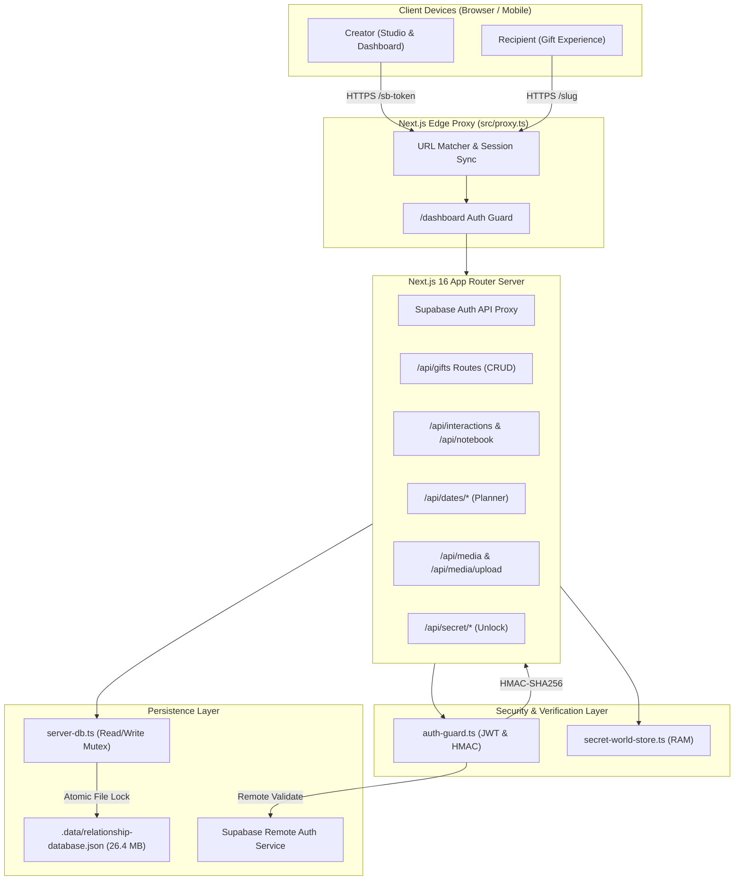
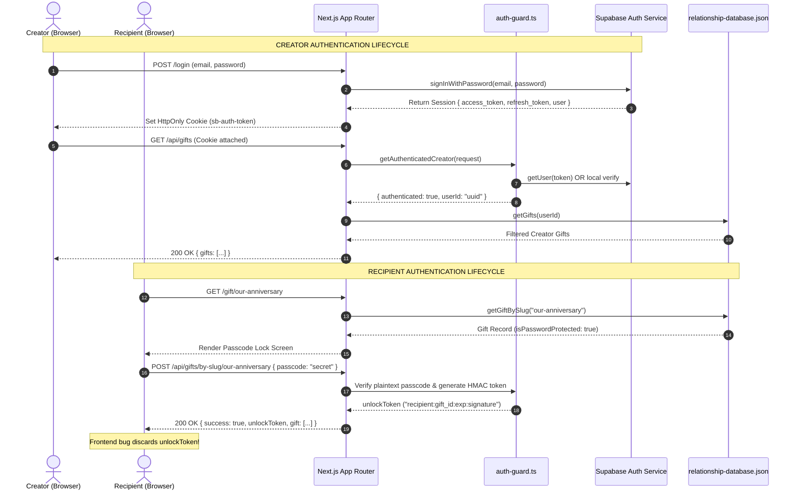
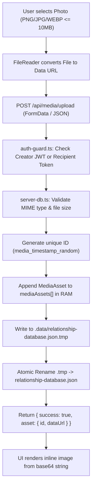
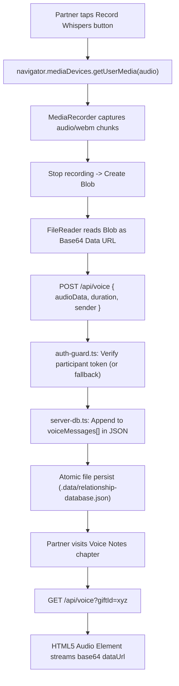
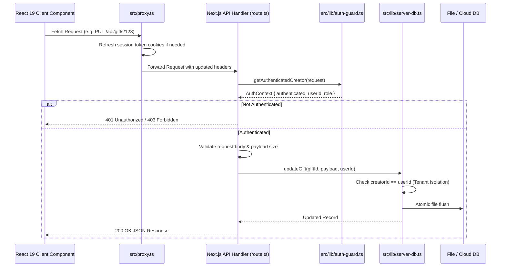
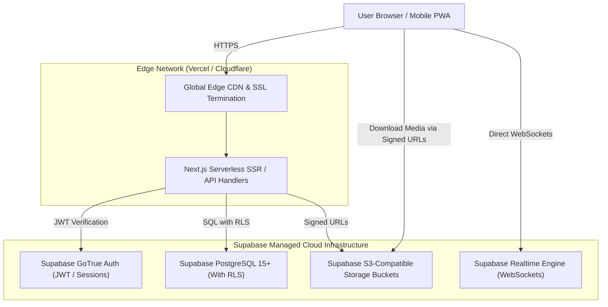

# System Architecture, Data Flow & Deployment Blueprints: GPTLevWeb

**Audit Date:** November 7, 2026  
**Auditor:** Principal Enterprise Systems Architect & Cloud Infrastructure Engineer  
**System:** GPTLevWeb Romantic Relationship Platform  
**Target Codebase:** `k:\keshavnewbranch\gptlevweb`

---

## 1. High-Level System Architecture

The current architecture is a monolithic Next.js 16 App Router application operating with a hybrid auth model and a local JSON persistence layer:

---

## 2. Authentication & Authorization Flow (Split-Brain Architecture)

The system enforces two completely distinct authentication pipelines:

---

## 3. Photo & Media Upload Lifecycle

Media assets are currently ingested, processed, and stored as Base64 strings directly inside the JSON database:

---

## 4. Voice Recording & Playback Lifecycle

---

## 5. Frontend-to-Backend Request Lifecycle

---

## 6. Complete Verified User Journey

```mermaid
flowchart TD
    Start(["New Visitor Opens Site"]) --> Landing["Landing Page (src/app/page.tsx)"]
    
    Landing --> Choice{"User Intent"}
    Choice -->|Explore Gift| SlugView["Personalized Gift URL (/gift/[slug])"]
    Choice -->|Create Gift| AuthCheck{"Logged In?"}
    
    AuthCheck -->|No| Login["Login / Signup Page (/login, /signup)"]
    Login --> Studio["Creator Studio (/studio)"]
    AuthCheck -->|Yes| Studio
    
    Studio --> Wizard["10-Step Gift Creation Wizard"]
    Wizard --> Basics["Step 1: Partner Names & Milestones"]
    Basics --> Welcome["Step 2: Opening Envelope Note"]
    Welcome --> Chapters["Step 3: Toggle & Reorder Chapters"]
    Chapters --> MediaUpload["Step 4: Upload Photos & Media"]
    MediaUpload --> PrivacyConfig["Step 5: Set Passcode & Passwords"]
    PrivacyConfig --> Preview["Live Preview (iPhone Simulator)"]
    Preview --> Publish["Publish Experience (Generate Slug)"]
    
    Publish --> Share["Copy Link & Share with Partner"]
    Share --> RecipientEnter["Partner Opens Link (/gift/[slug])"]
    
    RecipientEnter --> PasscodeCheck{"Passcode Protected?"}
    PasscodeCheck -->|Yes| EnterPasscode["Enter Romantic Passcode"]
    EnterPasscode --> GiftExperience["Romantic Interactive Web Experience"]
    PasscodeCheck -->|No| GiftExperience
    
    GiftExperience --> Ch1["1. Welcome Envelope Opening"]
    Ch1 --> Ch2["2. Things I Noticed About You"]
    Ch2 --> Ch3["3. Secret World (Password Gate)"]
    Ch3 --> Ch4["4. Scrapbook Memories (Polaroid Lightbox)"]
    Ch4 --> Ch5["5. Our Song (Spinning Vinyl & Chimes)"]
    Ch5 --> Ch6["6. Open When Letters"]
    Ch6 --> Ch7["7. Shared Notebook (Partner Journal)"]
    Ch7 --> Ch8["8. Date Planner (Proposals & Itineraries)"]
    Ch8 --> Ch9["9. Voice Whispers (Audio Playback)"]
    Ch9 --> Finale["10. Anniversary Counter & Heart Fireworks"]
```

---

## 7. Target Production Deployment Architecture (Supabase Migration Target)

