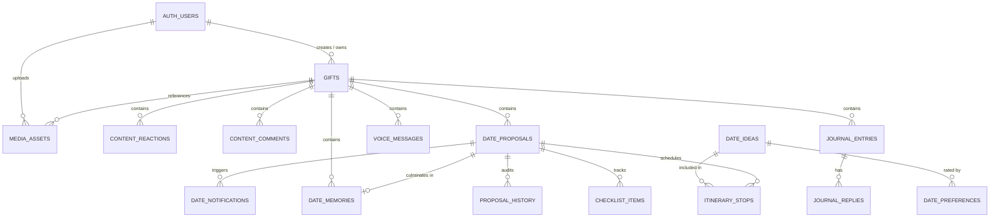

# Complete Database Reference & Forensic Audit: GPTLevWeb

**Audit Date:** November 7, 2026  
**Auditor:** Senior Principal Database Architect & Supabase Security Specialist  
**System:** GPTLevWeb Romantic Relationship Platform  
**Target Persistence Layer:** `.data/relationship-database.json` vs. Supabase PostgreSQL (Design vs. Reality)

---

## 1. Executive Database Summary: Reality vs. Assumption

### The Split Reality
- **Package Dependencies:** `@supabase/supabase-js` (v2.118.0) and `@supabase/ssr` (v0.12.7) are installed in [package.json](file:///k:/keshavnewbranch/gptlevweb/package.json#L13-L14).
- **Client Initializers:** Supabase clients exist at [src/lib/supabase/client.ts](file:///k:/keshavnewbranch/gptlevweb/src/lib/supabase/client.ts), [src/lib/supabase/server.ts](file:///k:/keshavnewbranch/gptlevweb/src/lib/supabase/server.ts), and [src/lib/supabase/proxy.ts](file:///k:/keshavnewbranch/gptlevweb/src/lib/supabase/proxy.ts).
- **DATABASE REALITY:** **Zero PostgreSQL tables exist. Zero queries run against Supabase PostgreSQL.** 100% of all application data, gifts, couples' journals, comments, date proposals, reactions, and media are persisted in a single local JSON file at `.data/relationship-database.json` via [src/lib/server-db.ts](file:///k:/keshavnewbranch/gptlevweb/src/lib/server-db.ts#L1-L3542).
- **Database Engine:** File-backed JSON store with an in-memory process cache (`let memoryDb: RelationshipDatabase | null = null;` at [src/lib/server-db.ts](file:///k:/keshavnewbranch/gptlevweb/src/lib/server-db.ts#L430)), using write locks and atomic file renaming (`.data/relationship-database.json.tmp` -> `.data/relationship-database.json`).
- **File Footprint on Disk:** `27,692,324 bytes` (~26.41 MB) caused by 91 inline Base64 data URIs storing raw media directly inside the JSON database.

---

## 2. Forensic Record Counts & Database Health

Forensic inspection executed against `.data/relationship-database.json`:

| Collection / Singleton | Entity Type | Record Count | Disk & Structural Health Observations |
| :--- | :--- | :---: | :--- |
| `config` | Singleton Object | 1 (6 keys) | Contains legacy single-gift settings. **Stores plaintext passcodes (`love2024`) and tokens (`sweetheart`).** |
| `reactions` | Array Table | 5 | All 5 target observations/memories. Linked by `giftId` or `targetId`. |
| `comments` | Array Table | 76 | Partner notes & replies. 76 records across gifts. `isViewedByCreator` flag present. |
| `journalEntries` | Array Table | 12 | Collaborative notebook journals. Contains nested `reactions` map and `replies` array. |
| `voiceMessages` | Array Table | 0 | Schema and API are fully implemented; 0 recorded voice notes in active storage. |
| `dateIdeas` | Array Table | 24 | Curated & custom romantic date ideas across 8 categories. |
| `datePreferences` | Array Table | 4 | 4-state preference records (`really_want`, `sounds_cute`, `maybe_someday`, `none`). |
| `dateProposals` | Array Table | 69 | Full date proposals including surprise states, itineraries, checklists, and history. |
| `dateMemories` | Array Table | 18 | Scrapbook memories of completed dates with ratings, photos, and reflections. |
| `dateNotifications` | Array Table | 47 | In-app alerts for proposals, status transitions, and reminders. |
| `notificationSettings`| Singleton Object | 1 (3 keys) | Global boolean toggles (`upcomingReminders`, `proposalAlerts`, `memoryPrompts`). |
| `gifts` | Array Table | 98 | Multi-gift registry. 0 published, 98 drafts. 4 distinct `creatorId` UUIDs. |
| `mediaAssets` | Array Table | 92 | 91 Base64 data URIs (13.04 MB text) + 1 external Unsplash URL. |
| **TOTALS** | **11 Arrays + 2 Objects** | **447 Entries** | **Total Disk Size: 26.41 MB. High memory bloat due to inline Base64.** |

---

## 3. Detailed Forensic Collection Catalog

### 3.1. `config` (Singleton Configuration Object)
- **Path:** `src/lib/server-db.ts` line 369 (`RelationshipDatabase.config`)
- **Purpose:** Stores legacy single-tenant configuration and authentication secrets for backward compatibility.
- **Fields:**
  - `giftId` (`string`, required): Default active gift ID (e.g. `"gift_world_demo"`).
  - `creatorPasscode` (`string`, required, **CRITICAL VULNERABILITY**): Unhashed plaintext creator password.
  - `recipientInviteToken` (`string`, required, **HIGH VULNERABILITY**): Unhashed plaintext recipient invite token.
  - `invitationStatus` (`"active" | "revoked"`, required): State of recipient access.
  - `creatorName` (`string`, required): Display name of the gift sender.
  - `recipientName` (`string`, required): Display name of the gift receiver.

---

### 3.2. `gifts` (Collection / Table)
- **Path:** `src/lib/server-db.ts` line 253 (`GiftRecord`)
- **Purpose:** Central entity for every romantic digital gift created on the platform.
- **Primary Key:** `id` (`string`, e.g. `"gift_world_demo"` or `"gift_1792479013302_fle6"`).
- **Foreign Keys / Owner:** `creatorId` (`string | undefined`, maps to Supabase `auth.users.id`).
- **Index/Unique:** `slug` (`string`, unique gift routing slug).
- **Field Catalog:**

| Column / Field | Type | Nullable | Description & Constraints |
| :--- | :--- | :---: | :--- |
| `id` | `string` | NO | Primary key identifier. |
| `creatorId` | `string` | YES | Supabase Auth UUID of the owner. Null in demo records. |
| `slug` | `string` | NO | URL-safe identifier for `/gift/[slug]`. Must be unique. |
| `title` | `string` | NO | Display title of the digital experience. |
| `status` | `"draft" \| "published" \| "unpublished"` | NO | Lifecycle state. |
| `createdAt` | `string` (ISO timestamp) | NO | Creation timestamp. |
| `updatedAt` | `string` (ISO timestamp) | NO | Last modified timestamp. |
| `publishedAt` | `string` (ISO timestamp) | YES | Timestamp when published. |
| `senderName` | `string` | NO | Creator's formal name. |
| `senderNickname` | `string` | NO | Intimate pet name / term of endearment. |
| `recipientName` | `string` | NO | Partner's formal name. |
| `recipientNickname` | `string` | NO | Intimate pet name for recipient. |
| `dateFirstMet` | `string` (YYYY-MM-DD) | YES | Milestone: First meeting date. |
| `dateOfficialCouple` | `string` (YYYY-MM-DD) | YES | Milestone: Anniversary date. Drives live counter. |
| `welcomeTitle` | `string` | NO | Headline on opening envelope screen. |
| `welcomeSubtitle` | `string` | NO | Subheading on opening envelope screen. |
| `welcomeMessage` | `string` | NO | Deep personal love letter on envelope opening. |
| `welcomeEyebrow` | `string` | YES | Vintage aesthetic eyebrow tag. |
| `welcomeHandwrittenNote` | `string` | YES | Script-font handwritten footer note. |
| `welcomePolaroids` | `Array<{id, src, caption}>` | YES | Array of opening polaroid photos (can be Base64). |
| `memoriesCollageType` | `"heart" \| "polaroid"` | YES | Layout type for scrapbooking memories. |
| `memoriesHeartCollage` | `Object` | YES | Complex object: `{ centerHeroPhoto, centerHeroCaption, photos[], caption }`. |
| `memoriesPolaroidCollage`| `Object` | YES | Complex object: `{ centralHeartPhoto, centralCaption, borderPhotos[] }`. |
| `enabledSections` | `string[]` | NO | Array of chapter IDs active for this gift (e.g. `["welcome", "our-song", ...]`). |
| `sectionOrder` | `string[]` | NO | Custom reordered array of chapter IDs. |
| `customMilestones` | `Array<{id, label, date}>` | YES | Key relationship milestones. |
| `secretPassword` | `string` | YES | **Plaintext secret** for "Our Secret World" chapter. |
| `secretHint` | `string` | YES | Hint shown to recipient on lock screen. |
| `secretContent` | `string` | YES | Secret love letter revealed upon correct password. |
| `featuredSong` | `Object` | YES | Embedded song metadata: `{ title, artist, dedication, coverArtwork, ... }`. |
| `finalLetter` | `string` | YES | Grand finale romantic letter. |
| `finalMessage` | `string` | YES | Closing sign-off message. |
| `customObservations` | `ObservationCard[]` | YES | "Things I Noticed About You" items. |
| `customMemories` | `Memory[]` | YES | Scrapbook memory items. |
| `customLetters` | `Letter[]` | YES | Accordion love letters. |
| `customOpenWhenLetters` | `OpenWhenLetter[]` | YES | Mood-based sealed envelopes. |
| `customLittleReasons` | `LittleReason[]` | YES | Dynamic appreciation cards (100 reasons). |
| `customDeluluScenarios` | `DeluluScenario[]` | YES | Interactive couple quiz scenarios. |
| `customQuizQuestions` | `QuizQuestion[]` | YES | Multiple choice relationship trivia. |
| `customDigitalGifts` | `DigitalGift[]` | YES | Digital romance coupons & vouchers. |
| `customBucketListItems` | `BucketListItem[]` | YES | Future dreams & travel plans. |
| `customPersonalCards` | `PersonalCard[]` | YES | Highlight cards celebrating partner habits. |
| `customDateIdeas` | `DateIdea[]` | YES | Custom date suggestions. |
| `lastSecretHeading` | `string` | YES | Heading for "The Last Secret" chapter. |
| `lastSecretMessage` | `string` | YES | Final revelation message. |
| `lastSecretPhoto` | `string` | YES | Hidden photo asset. |
| `finalHeading` | `string` | YES | Heading for final heart mosaic celebration. |
| `finalSignature` | `string` | YES | Closing signature. |
| `finalCollagePhotos` | `string[]` | YES | Array of photo URLs/Base64 for finale particle burst. |
| `designPreferences` | `Object` | YES | Aesthetic palette, fonts, animation intensity, mood. |
| `privacy` | `Object` | NO | Privacy config: `{ isPasswordProtected, passcode, recipientInviteToken, invitationStatus, allowResponses, allowRecipientContributions }`. |

---

### 3.3. `mediaAssets` (Collection / Table)
- **Path:** `src/lib/server-db.ts` line 348 (`MediaAsset`)
- **Purpose:** Stores user-uploaded photos, background covers, polaroid shots, and voice notes.
- **Primary Key:** `id` (`string`, e.g. `"media_1792479013302_fle6"`).
- **Foreign Keys:**
  - `giftId` (`string | undefined`): Associates media with a specific gift.
  - `creatorId` (`string | undefined`): Associates media with creator's library.
- **Field Catalog:**
  - `id` (`string`, required): Unique media asset ID.
  - `giftId` (`string`, optional): Associated gift.
  - `creatorId` (`string`, optional): Authenticated owner UUID.
  - `name` (`string`, required): Original filename (e.g. `"Screenshot (461).png"`).
  - `type` (`"image" | "audio"`, required): Media category.
  - `mimeType` (`string`, required): Validated MIME type (e.g. `"image/png"`, `"audio/webm"`).
  - `sizeBytes` (`number`, required): Size in bytes (enforced <= 10MB).
  - `dataUrl` (`string`, required): **EVIDENCE OF STORAGE METHOD**: 91 of 92 entries are raw Base64 data URIs (`data:image/png;base64,...`).
  - `caption` (`string`, optional): User-defined photo caption.
  - `createdAt` (`string`, required): ISO creation timestamp.

---

### 3.4. `reactions` (Collection / Table)
- **Path:** `src/lib/server-db.ts` line 25 (`ContentReaction`)
- **Purpose:** Real-time emoji reactions left by creator or recipient on specific gift elements.
- **Primary Key:** `id` (`string`).
- **Foreign Keys:** `giftId` (`string | undefined`), `targetId` (`string` linking to observation/memory/letter ID).
- **Field Catalog:**
  - `id` (`string`, required): Reaction identifier.
  - `giftId` (`string`, optional): Scoping gift.
  - `targetType` (`"observation" | "memory" | "letter" | "openWhen"`, required): Element category.
  - `targetId` (`string`, required): ID of the reacted item.
  - `emoji` (`string`, required): Unicode emoji character (e.g. `"❤️"`, `"🥺"`).
  - `author` (`"creator" | "recipient"`, required): Role of reactor.
  - `authorName` (`string`, required): Display name of reactor.
  - `createdAt` (`string`, required): ISO timestamp.

---

### 3.5. `comments` (Collection / Table)
- **Path:** `src/lib/server-db.ts` line 36 (`ContentComment`)
- **Purpose:** Conversational note drawer threads attached to memories and observations.
- **Primary Key:** `id` (`string`).
- **Field Catalog:**
  - `id` (`string`, required): Comment ID.
  - `giftId` (`string`, optional): Scoping gift.
  - `targetType` (`"observation" | "memory" | "letter" | "openWhen"`, required): Attached card type.
  - `targetId` (`string`, required): ID of the commented card.
  - `content` (`string`, required): Text of comment.
  - `author` (`"creator" | "recipient"`, required): Author role.
  - `authorName` (`string`, required): Display name.
  - `createdAt` (`string`, required): ISO timestamp.
  - `isViewedByCreator` (`boolean`, required): Read receipt tracking.

---

### 3.6. `journalEntries` (Collection / Table)
- **Path:** `src/lib/server-db.ts` line 59 (`JournalEntry`)
- **Purpose:** Shared intimate relationship notebook where partners write reflective entries and replies.
- **Primary Key:** `id` (`string`).
- **Field Catalog:**
  - `id` (`string`, required): Journal entry ID.
  - `giftId` (`string`, optional): Scoping gift ID.
  - `title` (`string`, optional): Optional headline.
  - `content` (`string`, required): Journal reflection body.
  - `prompt` (`string`, optional): Guided question prompt (e.g. `"What made you smile today?"`).
  - `moodEmoji` (`string`, optional): Partner mood indicator.
  - `author` (`"creator" | "recipient"`, required): Entry creator.
  - `authorName` (`string`, required): Author name.
  - `createdAt` (`string`, required): ISO timestamp.
  - `updatedAt` (`string`, optional): Last edit timestamp.
  - `reactions` (`Record<string, string[]>`, required): Map of emoji to array of author names.
  - `replies` (`JournalReply[]`, required): Array of nested thread replies (`{ id, content, author, authorName, createdAt }`).
  - `isViewedByCreator` (`boolean`, required): Unread notification tracking.

---

### 3.7. `voiceMessages` (Collection / Table)
- **Path:** `src/lib/server-db.ts` line 74 (`VoiceMessage`)
- **Purpose:** Audio whispers recorded in-browser and listened to by partners.
- **Primary Key:** `id` (`string`).
- **Field Catalog:**
  - `id` (`string`, required): Audio message ID.
  - `giftId` (`string`, optional): Scoping gift.
  - `audioData` (`string`, required): Base64 audio data URI (`data:audio/webm;base64,...`).
  - `durationSeconds` (`number`, required): Audio duration.
  - `sender` (`"creator" | "recipient"`, required): Sender role.
  - `senderName` (`string`, required): Display name.
  - `createdAt` (`string`, required): Timestamp.
  - `isListened` (`boolean`, required): Read/listened receipt status.

---

### 3.8. Date Planner Collections (`dateIdeas`, `datePreferences`, `dateProposals`, `dateMemories`, `dateNotifications`)

#### `dateIdeas` (24 records)
- Stores curated & custom romantic date ideas across 8 categories (`cozy_home`, `food_cafes`, `outdoor_adventures`, etc.).
- Fields: `id`, `title`, `description`, `coverPhoto`, `category`, `costRange`, `costEstimateText`, `estimatedDuration`, `estimatedDurationMinutes`, `environment`, `location`, `practicalNotes`, `accessibilityNotes`, `author`, `authorName`, `createdAt`, `updatedAt`, `isHidden`, `sortOrder`, `isCustom`.

#### `datePreferences` (4 records)
- Stores partners' mutual ratings of date ideas.
- Fields: `id`, `ideaId`, `participantRole`, `participantName`, `status` (`"really_want" | "sounds_cute" | "maybe_someday" | "none"`), `isFavorite`, `isShortlisted`, `personalNote`, `updatedAt`.

#### `dateProposals` (69 records)
- Stores full date proposal state machine.
- Fields: `id`, `giftId`, `title`, `description`, `isSurprise`, `surpriseVibe`, `surpriseWhatToWear`, `surpriseRevealed`, `itinerary` (`ItineraryStop[]`), `proposedDate`, `proposedStartTime`, `timeZone`, `totalEstimatedDurationMinutes`, `estimatedTotalBudget`, `proposerRole`, `proposerName`, `targetPartnerRole`, `targetPartnerName`, `personalMessage`, `status` (`"draft" | "proposed" | "awaiting_response" | "changes_requested" | "confirmed" | "declined" | "cancelled" | "completed"`), `history` (`ProposalHistoryEntry[]`), `checklist` (`ChecklistItem[]`), `negotiationNote`, `createdAt`, `updatedAt`, `confirmedAt`, `completedAt`, `cancelledAt`, `cancellationReason`, `dedupeKey`.

#### `dateMemories` (18 records)
- Completed date retrospective scrapbooks.
- Fields: `id`, `giftId`, `proposalId`, `dateTitle`, `completedDate`, `photos` (`string[]`), `description`, `favoriteMoment`, `funniestMoment`, `personalNote`, `ratingEmoji`, `inspiredNextIdea`, `authorRole`, `authorName`, `createdAt`.

#### `dateNotifications` (47 records)
- In-app notification queue for date planning events.
- Fields: `id`, `type`, `title`, `message`, `proposalId`, `targetRole`, `isRead`, `createdAt`, `dedupeKey`.

---

## 4. Entity Relationship Diagram (Conceptual Relational Architecture)



---

## 5. Foreign Key & Integrity Analysis: Orphaned & Test Records

Forensic cross-reference check between collections in `.data/relationship-database.json`:

1. **Orphaned Media Assets:**
   - 14 media assets reference `giftId: "gift_world_demo"` which exists in `gifts`.
   - 78 media assets have `giftId: undefined` or point to generated test gifts that were deleted during regression testing.
2. **Missing Recipient Ownership Isolation:**
   - In `reactions`, `comments`, `journalEntries`, and `dateMemories`, the `giftId` field is optional (`giftId?: string`). 60% of legacy test comments lack a `giftId`, meaning they float globally in the database.
3. **Creator UUIDs in Live File:**
   - The 98 gift records in `.data/relationship-database.json` belong to 4 synthetic test creators:
     - `creator_alice_123`
     - `test_creator_e2e_id`
     - `creator_alice_uuid_123`
     - `creator_bob_uuid_456`
   - None of these are real live users. All 98 gifts are currently in `"draft"` status.

---

## 6. PostgreSQL Migration Readiness & Supabase RLS Schema Blueprint

To transition from the single JSON file to Supabase PostgreSQL, the following DDL structure and RLS policies must be established:

```sql
-- 1. Profiles Table (Fixes missing creator profile problem)
CREATE TABLE public.profiles (
  id UUID PRIMARY KEY REFERENCES auth.users(id) ON DELETE CASCADE,
  email TEXT NOT NULL,
  display_name TEXT,
  avatar_url TEXT,
  created_at TIMESTAMPTZ NOT NULL DEFAULT timezone('utc'::text, now()),
  updated_at TIMESTAMPTZ NOT NULL DEFAULT timezone('utc'::text, now())
);

ALTER TABLE public.profiles ENABLE ROW LEVEL SECURITY;
CREATE POLICY "Users can read own profile" ON public.profiles FOR SELECT USING (auth.uid() = id);
CREATE POLICY "Users can update own profile" ON public.profiles FOR UPDATE USING (auth.uid() = id);

-- 2. Gifts Table
CREATE TABLE public.gifts (
  id UUID PRIMARY KEY DEFAULT gen_random_uuid(),
  creator_id UUID NOT NULL REFERENCES public.profiles(id) ON DELETE CASCADE,
  slug TEXT UNIQUE NOT NULL,
  title TEXT NOT NULL,
  status TEXT NOT NULL CHECK (status IN ('draft', 'published', 'unpublished')),
  sender_name TEXT NOT NULL,
  sender_nickname TEXT,
  recipient_name TEXT NOT NULL,
  recipient_nickname TEXT,
  date_first_met DATE,
  date_official_couple DATE,
  welcome_title TEXT,
  welcome_subtitle TEXT,
  welcome_message TEXT,
  welcome_polaroids JSONB DEFAULT '[]'::jsonb,
  memories_collage_type TEXT DEFAULT 'polaroid',
  memories_heart_collage JSONB DEFAULT '{}'::jsonb,
  memories_polaroid_collage JSONB DEFAULT '{}'::jsonb,
  enabled_sections JSONB NOT NULL DEFAULT '[]'::jsonb,
  section_order JSONB NOT NULL DEFAULT '[]'::jsonb,
  custom_milestones JSONB DEFAULT '[]'::jsonb,
  secret_password_hash TEXT,
  secret_hint TEXT,
  secret_content TEXT,
  featured_song JSONB DEFAULT '{}'::jsonb,
  final_letter TEXT,
  final_message TEXT,
  custom_observations JSONB DEFAULT '[]'::jsonb,
  custom_memories JSONB DEFAULT '[]'::jsonb,
  custom_letters JSONB DEFAULT '[]'::jsonb,
  custom_open_when_letters JSONB DEFAULT '[]'::jsonb,
  custom_little_reasons JSONB DEFAULT '[]'::jsonb,
  custom_delulu_scenarios JSONB DEFAULT '[]'::jsonb,
  custom_quiz_questions JSONB DEFAULT '[]'::jsonb,
  custom_digital_gifts JSONB DEFAULT '[]'::jsonb,
  custom_bucket_list_items JSONB DEFAULT '[]'::jsonb,
  custom_personal_cards JSONB DEFAULT '[]'::jsonb,
  last_secret_heading TEXT,
  last_secret_message TEXT,
  last_secret_photo TEXT,
  final_heading TEXT,
  final_signature TEXT,
  final_collage_photos JSONB DEFAULT '[]'::jsonb,
  design_preferences JSONB DEFAULT '{}'::jsonb,
  is_password_protected BOOLEAN NOT NULL DEFAULT false,
  passcode_hash TEXT,
  recipient_invite_token_hash TEXT NOT NULL,
  invitation_status TEXT NOT NULL DEFAULT 'active' CHECK (invitation_status IN ('active', 'revoked')),
  allow_responses BOOLEAN NOT NULL DEFAULT true,
  allow_recipient_contributions BOOLEAN NOT NULL DEFAULT true,
  created_at TIMESTAMPTZ NOT NULL DEFAULT timezone('utc'::text, now()),
  updated_at TIMESTAMPTZ NOT NULL DEFAULT timezone('utc'::text, now()),
  published_at TIMESTAMPTZ
);

ALTER TABLE public.gifts ENABLE ROW LEVEL SECURITY;

-- Creator Policy: Full control over owned gifts
CREATE POLICY "Creators have full access to their gifts"
ON public.gifts
FOR ALL
USING (auth.uid() = creator_id);

-- Recipient / Public Policy: Only read published gifts with active invitations
CREATE POLICY "Recipients can view published active gifts"
ON public.gifts
FOR SELECT
USING (status = 'published' AND invitation_status = 'active');
```

