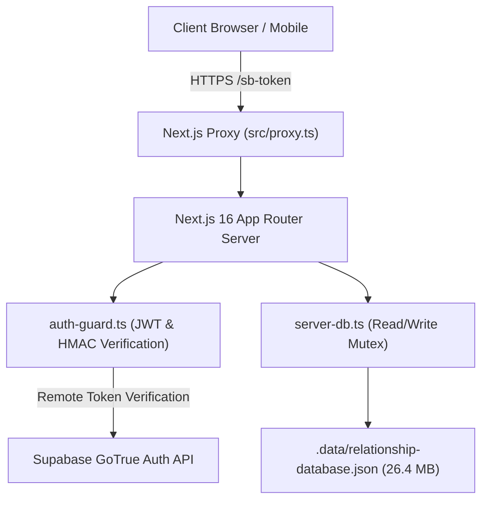

# Master Project Blueprint & Architecture Context: GPTLevWeb

> **Document Classification:** Master AI Onboarding & Architecture Blueprint  
> **Auditor & Author:** Senior Principal Software Architect, Application Security Engineer & Systems Specialist  
> **Target Repository:** `GPTLevWeb` (Romantic Relationship Platform)  
> **Generation Date:** November 7, 2026  
> **Purpose:** Completely self-contained technical and product blueprint to onboard any senior engineer or AI assistant to the project without requiring prior context.

---

## 1. Project Overview
**GPTLevWeb** is a romantic digital experience platform designed for couples to celebrate their relationships, preserve shared memories, exchange private love letters and audio whispers, plan collaborative dates, and present custom-tailored interactive anniversary websites to their partners.

The platform provides two primary user experiences:
1. **The Creator Experience:** A web-based studio (`/studio` and `/create`) where a creator builds a multi-chapter personalized website using a 10-step wizard, section editor registry, media library, and live device simulator.
2. **The Recipient Experience:** An interactive, emotionally resonant web app delivered at `/gift/[slug]` featuring envelope opening animations, Polaroid scrapbooks, spinning vinyl records with synthesized pentatonic chimes, sealed "Open When" letters, interactive couple quizzes, and collaborative date planners.

---

## 2. Product Vision
To replace generic physical greeting cards and disconnected photo albums with an intimate, private, interactive digital heirloom. The platform balances visual luxury (warm blush tones, gold foil textures, realistic envelope physics, polaroid tilt effects) with meaningful intimacy (custom love letters, secret password-protected chambers, mutual date preference discovery, and collaborative journals).

---

## 3. Target Users
1. **Creators (Gift Senders):** Individuals planning anniversaries, Valentine's Day surprises, birthdays, proposals, or romantic milestones who want to craft a tailored digital experience for their significant other.
2. **Recipients (Partners):** Partners who receive the private link, unlock it with a shared passcode, experience the interactive chapters, and interactively respond via comments, reactions, voice whispers, and date proposals.

---

## 4. Complete Technology Stack

| Layer | Technologies & Libraries | Version | Verification Source |
| :--- | :--- | :---: | :--- |
| **Framework** | Next.js (App Router, Turbopack) | `16.4.2` | [package.json](file:///k:/keshavnewbranch/gptlevweb/package.json#L17) |
| **UI Library** | React (Concurrent mode, Server Actions) | `19.3.0` | [package.json](file:///k:/keshavnewbranch/gptlevweb/package.json#L18) |
| **Language** | TypeScript (Strict mode) | `5.x` | [package.json](file:///k:/keshavnewbranch/gptlevweb/package.json#L29) |
| **Styling** | Tailwind CSS (Turbopack engine) | `4.x` | [package.json](file:///k:/keshavnewbranch/gptlevweb/package.json#L28) |
| **Motion & Physics** | Framer Motion | `14.3.0` | [package.json](file:///k:/keshavnewbranch/gptlevweb/package.json#L15) |
| **Iconography** | Lucide React | `1.58.0` | [package.json](file:///k:/keshavnewbranch/gptlevweb/package.json#L16) |
| **Auth Client** | `@supabase/supabase-js`, `@supabase/ssr` | `2.118.0`, `0.12.7`| [package.json](file:///k:/keshavnewbranch/gptlevweb/package.json#L13-L14) |
| **Current Persistence**| File-backed JSON Database with write lock | Custom | [src/lib/server-db.ts](file:///k:/keshavnewbranch/gptlevweb/src/lib/server-db.ts) |
| **Target Persistence** | Supabase Managed PostgreSQL 15+ with RLS | Target | Design Target |
| **Target Storage** | Supabase S3-Compatible Object Storage | Target | Design Target |
| **Linting & Code Quality**| ESLint 9 with `eslint-config-next` | `16.4.2` | [package.json](file:///k:/keshavnewbranch/gptlevweb/package.json#L26-L27) |

---

## 5. System Architecture
The application runs as a hybrid serverless Next.js 16 application. Incoming requests pass through an Edge Proxy (`src/proxy.ts` invoking `src/lib/supabase/proxy.ts`) which refreshes Supabase session tokens and enforces redirects. API routes in `src/app/api/` enforce authorization via `src/lib/auth-guard.ts`. Data is currently persisted into `.data/relationship-database.json` via mutex-wrapped atomic file writes.



---

## 6. Complete Directory Structure

```
gptlevweb/
├── .data/
│   └── relationship-database.json      # Single file JSON store (26.4 MB, 447 entries)
├── public/                             # Static public assets (images, icons, textures)
├── scripts/
│   ├── fetch-scenes.mjs                # Scene asset fetcher
│   ├── regression-suite.ts             # 33 application regression assertions
│   ├── run-all-tests.mjs               # Test orchestrator (starts Next server & runs suites)
│   ├── security-regression-suite.ts    # 245 security regression assertions
│   ├── security-regression-tests.mjs   # Standalone runner for security tests
│   ├── test-story-universe.mjs         # Story route integration tests
│   └── test-suite.mjs                  # Core route health checks
├── src/
│   ├── proxy.ts                        # Next.js 16 Edge proxy matcher
│   ├── app/
│   │   ├── (auth)/                     # Creator authentication route group
│   │   │   ├── login/page.tsx          # Creator sign-in page
│   │   │   └── signup/page.tsx         # Creator registration page
│   │   ├── api/                        # 24 backend API route handlers
│   │   │   ├── auth/access/route.ts    # Recipient access & unlock token issuance
│   │   │   ├── auth/callback/route.ts  # OAuth callback handler
│   │   │   ├── creator/responses/route.ts # Creator response summary & read receipts
│   │   │   ├── dates/                  # Date planner API routes (ideas, memories, proposals)
│   │   │   ├── gifts/                  # Gift CRUD, publishing, slug routes
│   │   │   ├── interactions/           # Comments and emoji reactions routes
│   │   │   ├── media/                  # Media library and file upload routes
│   │   │   ├── notebook/route.ts       # Shared couple journal routes
│   │   │   ├── secret/                 # Secret chamber config & verification routes
│   │   │   └── voice/route.ts          # Voice whisper audio routes
│   │   ├── create/page.tsx             # Standalone creation wizard
│   │   ├── dashboard/page.tsx          # Creator dashboard (redirects to /studio)
│   │   ├── gift/[slug]/page.tsx        # Dynamic recipient gift presentation page
│   │   ├── story/                      # 16 individual story chapter pages
│   │   ├── story-universe/page.tsx     # Master chapter navigation hub
│   │   ├── studio/page.tsx             # Full multi-gift creator studio
│   │   ├── globals.css                 # Global Tailwind CSS and styling variables
│   │   └── layout.tsx                  # Root HTML layout and font loading
│   ├── components/
│   │   ├── auth/                       # Participant access modal
│   │   ├── creator/                    # Studio components
│   │   ├── creator-wizard/             # 10 wizard step panels
│   │   ├── interactions/               # Comments and emoji reactions drawer
│   │   ├── planner/                    # Date planner views (catalog, proposals, memories)
│   │   ├── sections/                   # 15 interactive gift chapter sections
│   │   ├── stories/                    # Story cards and players
│   │   ├── story/                      # Story headers, footers, and overlays
│   │   └── studio/                     # Studio modals (media library, live preview, publish)
│   └── lib/
│       ├── auth-guard.ts               # Core security guard (JWT verification, HMAC tokens)
│       ├── creator-defaults.ts         # Default template data for new gifts
│       ├── creator-types.ts            # Type definitions for creator wizards
│       ├── gift-data.ts                # Legacy gift models and data structures
│       ├── layout-utils.ts             # CSS styling and responsive layout utilities
│       ├── motion.ts                   # Framer motion transition presets
│       ├── reasons-data.ts             # 100 default reasons why I love you
│       ├── secret-world-store.ts       # In-memory store for secret chamber configs
│       ├── server-db.ts                # 3,542-line JSON database access layer
│       ├── stories-data.ts             # Story universe chapter registry
│       ├── story-routes.ts             # Routing constants for story chapters
│       └── supabase/                   # Supabase client, server, and proxy helpers
├── .env.example                        # Template for required environment variables
├── .env.local                          # Local environment variables (URL, Anon Key, Unlock Secret)
├── ARCHITECTURE.md                     # System architecture & Mermaid diagrams
├── DATABASE_REFERENCE.md               # Forensic schema and field reference
├── FEATURE_INVENTORY.md                # Complete feature and route mapping
├── IMPLEMENTATION_STATUS.md            # Verified status matrix of all features
├── package.json                        # NPM package specifications
├── SECURITY_AUDIT.md                   # Complete vulnerability report & CVSS scores
└── tsconfig.json                       # TypeScript compiler options
```

---

## 7. All Discovered Features
1. **Interactive Opening Envelope Experience:** Envelope flap physics, wax seal click, audio chime cue, and romantic note.
2. **Habit Cards ("Things I Noticed About You"):** Categorized quirks, real-time emoji reactions, and comment threads.
3. **Secret Chamber ("Our Secret World"):** Passcode lock, 5-attempt rate limit, 30-second lockout cooldown, hidden photo reveal.
4. **Scrapbook Memories:** Polaroid cards, category tags, recollection notes, and zoomable modal lightbox.
5. **Vinyl Player ("Our Song"):** Spinning record animation, track metadata, and Web Audio synthesized pentatonic melodies.
6. **Open When Sealed Letters:** Mood stamps, envelope opening animations, heartfelt reading modal.
7. **Delulu Mode:** 6 couple scenarios with interactive multiple-choice options and humorous dialogue bubbles.
8. **Couple Trivia Quiz:** Side-by-side answer comparisons and compatibility scorecards.
9. **Love Letters Accordion:** Intimate letters with drop caps and date stamps.
10. **100 Reasons Why I Love You:** Appreciation deck with true randomized note picker and bookmark drawer.
11. **Digital Romance Coupons:** Claimable vouchers with timestamp logging and duplicate redemption prevention.
12. **Shared Couple Notebook:** Collaborative journal with prompts, mood emojis, and replies.
13. **Voice Whispers:** 2-way in-browser audio recording (MediaRecorder API) and audio player.
14. **Collaborative Date Planner:** 24 ideas catalog, 4-state preference scale, multi-stop itinerary builder, surprise proposal state machine, and retrospective memories gallery.
15. **Anniversary Counter & Heart Finale:** Real-time anniversary countdown ticker, heart mosaic, and particle burst explosion.
16. **Creator Studio:** Multi-gift dashboard, 10-step wizard, section editor registry, media library, autosave, live mobile simulator, and instant publishing.

---

## 8. All Frontend Routes and Components
- **Routes:** 27 `page.tsx` routes across `src/app/` (see [FEATURE_INVENTORY.md](file:///k:/keshavnewbranch/gptlevweb/FEATURE_INVENTORY.md)).
- **Core Components:**
  - `src/components/sections/*` (15 chapter components).
  - `src/components/studio/*` (Creator Studio modals and editors).
  - `src/components/planner/*` (8 Date Planner sub-components).
  - `src/components/creator-wizard/*` (10 wizard steps).

---

## 9. Complete User Journeys
Detailed end-to-end flows for both Creator and Recipient are documented with Mermaid diagrams in [ARCHITECTURE.md](file:///k:/keshavnewbranch/gptlevweb/ARCHITECTURE.md#L6).

---

## 10. Backend Architecture
The backend is implemented via 24 Next.js App Router API routes located at `src/app/api/*`. All mutations and reads pass through:
1. `src/lib/auth-guard.ts`: Enforces JWT verification via Supabase or local HMAC-SHA256 tokens.
2. `src/lib/server-db.ts`: Orchestrates all database mutations, validation rules, read receipts, and atomic disk persistence.

---

## 11. Complete API Inventory

| HTTP Method | Route | Description | Auth Requirement |
| :--- | :--- | :--- | :--- |
| `POST` | `/api/auth/access` | Issues recipient unlock token after passcode check | Public / Passcode |
| `GET` | `/api/auth/callback` | Supabase OAuth code exchange callback | Public |
| `GET, POST` | `/api/creator/responses` | Creator response summary & mark-as-viewed | Verified Creator JWT |
| `GET` | `/api/dates/ideas` | Fetch curated & custom date ideas | Public / Recipient |
| `GET, POST` | `/api/dates/memories` | Fetch & add date retrospective scrapbooks | None (GET) / Token (POST) |
| `GET, POST` | `/api/dates/notifications`| Fetch & acknowledge date notifications | Participant Token |
| `GET, PUT` | `/api/dates/notifications/settings`| Notification preference toggles | Participant Token |
| `GET, POST` | `/api/dates/preferences`| Mutual rating of date ideas | Participant Token |
| `GET, POST` | `/api/dates/proposals` | List & create date proposals | Participant Token |
| `GET, PUT, DELETE`| `/api/dates/proposals/[id]`| Manage single proposal & details | Participant Token |
| `PUT` | `/api/dates/proposals/[id]/checklist`| Update date checklist tasks | Participant Token |
| `POST` | `/api/dates/proposals/[id]/transition`| Advance proposal state machine | Participant Token |
| `GET, POST` | `/api/gifts` | List creator gifts OR create new gift | Public (GET) / Creator (POST) |
| `GET, POST` | `/api/gifts/by-slug/[slug]`| Fetch public gift OR verify passcode | Public / Passcode |
| `GET, PUT, DELETE`| `/api/gifts/[id]` | Read draft, update gift, or delete gift | Creator JWT or Unlock Token |
| `POST` | `/api/gifts/[id]/publish`| Publish / unpublish gift | Creator JWT |
| `GET, POST` | `/api/interactions/comments`| Read & post memory/habit comments | None (GET) / Token (POST) |
| `GET, POST` | `/api/interactions/reactions`| Read & toggle emoji reactions | None (GET) / Token (POST) |
| `GET, DELETE`| `/api/media` | List media assets or delete asset | Creator JWT or Unlock Token |
| `POST` | `/api/media/upload` | Upload image or audio file (<= 10MB) | Creator JWT or Unlock Token |
| `GET, POST` | `/api/notebook` | Read & post couple journal entries | None (GET) / Token (POST) |
| `GET, POST` | `/api/secret/config` | Manage secret chamber password & hint | Creator JWT |
| `POST` | `/api/secret/verify` | Verify secret chamber password | Rate-Limited (5 tries) |
| `GET, POST` | `/api/voice` | Read & upload voice whispers (audio) | None (GET) / Token (POST) |

---

## 12. Database Schema
Full collection specifications, data types, nullability, and relational maps are detailed in [DATABASE_REFERENCE.md](file:///k:/keshavnewbranch/gptlevweb/DATABASE_REFERENCE.md).

---

## 13. Table Relationships
Documented in Section 4 of [DATABASE_REFERENCE.md](file:///k:/keshavnewbranch/gptlevweb/DATABASE_REFERENCE.md#L4).

---

## 14. Actual Database Status & Record Counts
Inspected directly from `.data/relationship-database.json`:
- **Total Array Records:** 445 records across 11 collections + 2 singleton objects = **447 total entries**.
- **Disk Footprint:** 26.41 MB (caused by 91 inline Base64 data URIs).
- **Existing Records:** 98 draft gifts, 92 media assets, 76 comments, 69 date proposals, 47 notifications, 24 date ideas, 18 date memories, 12 journal entries, 5 reactions, 4 date preferences, 0 voice notes.

---

## 15. File Storage Architecture
- **Current Reality:** Zero cloud object storage. Uploaded files are converted to Base64 data URIs (`data:image/png;base64,...`) and stored in `.data/relationship-database.json`.
- **Target Architecture:** Supabase Storage private S3 buckets (`photos`, `audio`) with access controlled via signed URLs and gift unlock tokens.

---

## 16. Image Handling
Images uploaded via `MediaLibraryModal` or `WizardPhotoLibraryModal` are validated on the client and server for MIME type (`image/jpeg`, `image/png`, `image/webp`, `image/gif`) and file size (<= 10MB). Image optimization is handled by Next.js `<Image />` where configured.

---

## 17. Voice Recording and Playback Architecture
- **Recording:** Client browser uses `navigator.mediaDevices.getUserMedia({ audio: true })` and `MediaRecorder` to record `audio/webm` chunks.
- **Payload:** Chunks are compiled into a Blob, converted to Base64 data URI via `FileReader`, and sent to `POST /api/voice`.
- **Playback:** Rendered via custom HTML5 audio elements streaming the Base64 data URI.

---

## 18. Authentication
- **Creator Auth:** Supabase Auth (`supabase.auth.signInWithPassword`, `signUp`). Session tokens stored in cookies (`sb-<ref>-auth-token`) and refreshed via `src/lib/supabase/proxy.ts`. Verified in `auth-guard.ts` via Supabase JWT verification.
- **Recipient Auth:** Non-Supabase custom HMAC tokens issued via `POST /api/gifts/by-slug/[slug]` upon correct passcode entry.

---

## 19. Authorization
- **Creator Isolation:** Verified in `auth-guard.ts` and `server-db.ts` by checking `gift.creatorId === auth.userId`.
- **Recipient Scoping:** Scoped to individual gifts via HMAC token payload (`recipient:<giftId>:<exp>:<sig>`).

---

## 20. Security Implementation
Detailed in [SECURITY_AUDIT.md](file:///k:/keshavnewbranch/gptlevweb/SECURITY_AUDIT.md). Confirmed vulnerabilities include mass gift enumeration (`GET /api/gifts`), unauthenticated notebook/voice reading, spoofable participant mutations, and plaintext password storage.

---

## 21. Environment Variables

| Variable | Purpose | Configuration Status | Sensitive |
| :--- | :--- | :---: | :---: |
| `NEXT_PUBLIC_SUPABASE_URL` | Supabase Cloud API Gateway URL | Configured in `.env.local` | No (Public) |
| `NEXT_PUBLIC_SUPABASE_PUBLISHABLE_KEY` | Supabase Anon Key for browser client | Configured in `.env.local` | No (Public) |
| `SUPABASE_JWT_SECRET` | Secret for local HMAC JWT verification | Not configured (Falls back to remote verify) | **Yes (Secret)** |
| `GIFT_UNLOCK_SECRET` | 76-character secret for HMAC media tokens | Configured in `.env.local` | **Yes (Secret)** |

---

## 22. Third-Party Integrations
1. **Supabase Cloud:** Authentication (GoTrue). Target database and storage.
2. **Unsplash:** Fallback external photography URLs for demo cards.

---

## 23. Deployment Architecture
- **Current Target:** Next.js deployment (Vercel, Node.js container, or Cloudflare Pages).
- **Blocker:** Local JSON file persistence (`.data/relationship-database.json`) is incompatible with stateless serverless hosting (Vercel/AWS Lambda) because writes are local to the container filesystem and lost on cold-starts.

---

## 24. Current Bugs
1. **Frontend Unlock Token Discard Bug:** `src/app/gift/[slug]/page.tsx` line 90 discards `data.unlockToken`, breaking protected media fetches.
2. **Secret World Ephemeral RAM Flaw:** `src/lib/secret-world-store.ts` stores passwords in JavaScript memory, losing data on restart.
3. **Passcode Error Feedback Missing:** `passcodeError` state in `src/app/gift/[slug]/page.tsx` line 44 is never set on invalid password submissions.

---

## 25. Known Limitations
1. Single-file JSON database cannot scale beyond a few megabytes or support concurrent multi-instance writes.
2. Inline Base64 images cause heavy memory bloat in Node.js processes.
3. No creator profile editor or password reset flows exist.

---

## 26. Technical Debt
1. 3,542 lines of procedural database logic in `src/lib/server-db.ts` that should be replaced with Supabase PostgreSQL queries and RLS policies.
2. 50 ESLint warnings regarding React 19 strict state synchronization in `useEffect`.

---

## 27. Testing Status
- **TypeScript:** Passed with 0 errors (`npx tsc --noEmit`).
- **ESLint:** Passed with 0 errors, 50 warnings (`npm run lint`).
- **Security Regression Suite:** 245/245 assertions pass (`scripts/security-regression-suite.ts`).
- **Application Regression Suite:** 33/33 assertions pass (`scripts/regression-suite.ts`).

---

## 28. Current Implementation Status Matrix
Complete feature-by-feature matrix is detailed in [IMPLEMENTATION_STATUS.md](file:///k:/keshavnewbranch/gptlevweb/IMPLEMENTATION_STATUS.md).

---

## 29. Outstanding Tasks (Production Readiness)
1. Close all confirmed security gaps (SEC-01 through SEC-07).
2. Execute PostgreSQL schema migration to Supabase.
3. Implement Supabase Storage bucket uploads for images and audio.
4. Fix the frontend `unlockToken` retention bug.
5. Hash all stored passwords with Argon2id / bcrypt.

---

## 30. Prioritized Roadmap

### P0: Critical Security & Data Loss Fixes
- Fix mass gift leak in `GET /api/gifts` (SEC-01).
- Add authentication guards to `GET /api/notebook`, `GET /api/voice`, `GET /api/interactions/comments` (SEC-02).
- Fix identity spoofing on mutation endpoints (SEC-03).
- Fix frontend `unlockToken` discard bug in `src/app/gift/[slug]/page.tsx` (SEC-06).

### P1: Database & Storage Migration
- Run PostgreSQL migration script to establish Supabase tables.
- Migrate 445 JSON records to PostgreSQL.
- Move Base64 images and audio out of JSON and into Supabase Storage buckets.
- Implement Row Level Security (RLS) policies.

### P2: User Experience Polish
- Add Creator Profile management (`/profile`).
- Add Password Reset / Forgot Password flow.
- Add real-time Supabase WebSockets for instant partner reactions and comments.

### P3: Performance & Optimization
- Resolve 50 React 19 ESLint warnings.
- Implement progressive image loading and WebP conversion.

---

## 31. Important Architectural Decisions
1. **Decision to Migrate from JSON to Supabase:** The JSON database was created during rapid prototyping, but its 26.4MB size and memory caching prevent horizontal scaling and reliable serverless operation.
2. **Decision on Recipient Auth Model:** Recipients should not be forced to create a full Supabase email/password account. Instead, Supabase Anonymous Authentication with signed session tokens will bridge recipient access into Row Level Security.

---

## 32. Unknowns and Unverified Assumptions
1. **Production Supabase DB Password & Service Role Key:** Not present in local repository files. Required before running production database migrations.
2. **Target Hosting Provider & Production Domain:** Vercel or cloud provider configurations are not defined in repo files.

